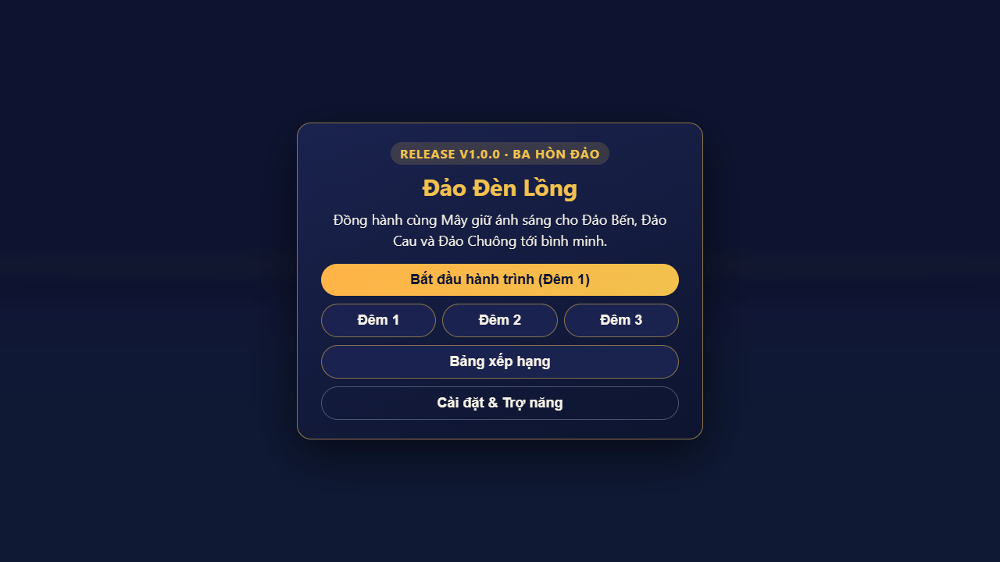
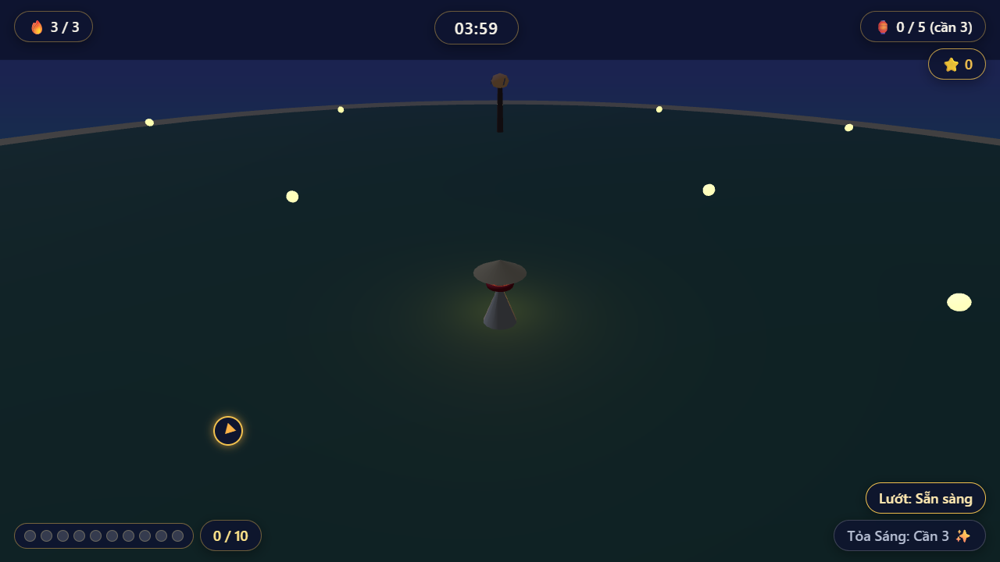
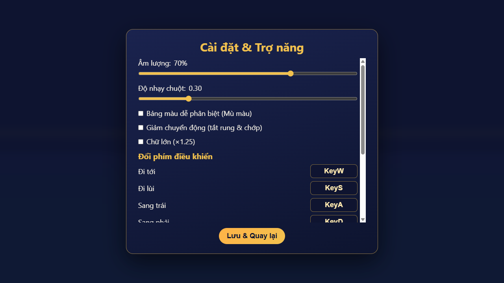

# Đảo Đèn Lồng — v1.0.0 (Contract v1.3)

Game 3D cổ tích góc nhìn thứ ba: điều khiển **Mây** (người giữ đèn đội nón lá) vượt qua **3 Đêm** — **Đảo Bến**, **Đảo Cau** và **Đảo Chuông** — giữ đủ ánh sáng trên các Đèn Lồng Lớn tới bình minh trước sự săn đuổi của Bóng Mực và Gió Lạc.

## Ảnh chụp màn hình (1280×720)

| Menu chính | Gameplay Đêm 1 & HUD | Cài đặt & Trợ năng |
|---|---|---|
|  |  |  |

---

## Yêu cầu hệ thống
- **Node.js >= 20** (chạy trực tiếp trên macOS, Linux và Windows).
- Trình duyệt hỗ trợ WebGL2 (Chrome / Edge / Firefox / Safari) để chơi bản 3D và chạy chế độ benchmark.

---

## Cài đặt & Chạy game (≤ 3 lệnh)

```bash
npm install && npm run build
node scripts/run.js
```

Mở trình duyệt tại `http://127.0.0.1:4173` để chơi game (hoặc dùng `npm run dev` cho chế độ phát triển).

---

## Các lệnh kiểm chứng, Headless, Benchmark, Soak & Bảng xếp hạng

```bash
# Chạy toàn bộ bộ test (unit + regression P1/P2/P3 + determinism)
npm run verify

# Chạy headless theo Test Contract v1.3 (--night 1 | 2 | 3)
node src/headless.js --seed 42 --night 1 --ticks 600 --out out.jsonl

# Chạy benchmark 1280×720 (200 Bóng Mực, 100 đom đóm, tắt vsync qua cờ Chromium)
node scripts/bench.js --seed 42 --duration 30 --out bench.json

# Chạy soak test 10 Đêm liên tiếp trong cùng tiến trình
node scripts/soak.js --seed 7 --nights 10 --out soak.json

# Xuất bảng xếp hạng cục bộ ra JSON
node scripts/run.js --export-leaderboard leaderboard_export.json
```

> **Ghi chú về VSync & Bộ nhớ bản Web:** `scripts/bench.js` khởi chạy Chromium/Chrome/Edge với cờ `--disable-gpu-vsync --disable-frame-rate-limit` (`vsync_off: true`). Trên một số trình duyệt không bật API `performance.memory`, trường `peak_mem_mb` sẽ ghi `null` theo quy định Contract v1.3.

---

## Điều khiển (mặc định — đổi phím được trong Cài đặt)

| Phím / Chuột | Hành động |
|---|---|
| `W / A / S / D` hoặc `↑ / ↓` | Di chuyển Mây theo hướng camera |
| `Space` | Nhảy |
| `Shift` | Lướt (Dash: `14 m/s`, `0.2s`, hồi chiêu `1.5s`, giữ độ cao trên không) |
| Kéo chuột trái hoặc `← / →` | Xoay camera 3D |
| `E` | Nạp ánh sáng (đèn tắt) hoặc Châm dầu (đèn sáng chưa đầy) |
| `F` hoặc Chuột phải | Tỏa Sáng (Pulse: tốn `3` đom đóm, bán kính 3D `5m`, hồi chiêu `3s`) |
| `Esc` hoặc `P` | Tạm dừng / Mở menu tạm dừng |

---

## Luật chơi & Cách tính điểm (Contract v1.3)

- **Thắng Đêm (`dawn_survived`):** Sống sót tới hết giờ (Đêm 1/2/3: `240 / 270 / 300s`) với số đèn sáng `>= ceil(0.6 × tổng đèn)` (`3/5`, `4/6`, `5/7`).
- **Nhiên liệu đèn:** Đèn sáng bắt đầu ở `100` dầu, hao `1.0/s`; đèn `< 30` dầu mất vùng an toàn `6m` và bị Bóng Mực hút `5/s`. Hết dầu đèn tắt (`ever_lit = true`), thắp lại chỉ tốn `5` đom đóm (lần đầu `10`).
- **Sức chứa tăng dần:** `min(20, 10 + 2 × số lần thắp thành công trong Đêm)`.
- **Điểm:** `+5`/đom đóm nạp hoặc châm dầu · `+100` thắp lần đầu · `+40` thắp lại · `+5` Pulse Bóng Mực thường / `+15` Pulse Bóng Mực đang hút dầu (`drain`) · thắng bình minh: `+(50 + floor(fuel))`/đèn sáng + `+50`/Ngọn Lửa còn lại.

---

## Sáng tạo của tôi & Trợ năng
- **Âm thanh tổng hợp Web Audio API (`src/render/audio.js`):** Nhạc nền ngũ cung đêm + 13 hiệu ứng âm thanh, tự tắt trong chế độ headless và benchmark.
- **Trợ năng đầy đủ:** Chế độ mù màu (`#00B3FF`, `#FFFFFF + ⚠`, đèn tắt xẹp 20% + vết rách), đổi phím 9 hành động chống trùng, phụ đề hình ảnh + mũi tên hướng Bóng Mực mới xuất hiện, Giảm chuyển động, cỡ chữ UI `>= 18px` + Chữ lớn `×1.25`.

---

## Tài liệu dự án
- [`game.contract.json`](game.contract.json) · [`AGENTS.md`](AGENTS.md) · [`LICENSE`](LICENSE) · [`CREDITS.md`](CREDITS.md)
- [`docs/CHANGELOG.md`](docs/CHANGELOG.md) · [`docs/ADR_PHASE3_FUEL_AND_WIN.md`](docs/ADR_PHASE3_FUEL_AND_WIN.md) · [`docs/RETRO.md`](docs/RETRO.md)
- [`docs/EVIDENCE_PHASE1.md`](docs/EVIDENCE_PHASE1.md) · [`docs/EVIDENCE_PHASE2.md`](docs/EVIDENCE_PHASE2.md) · [`docs/EVIDENCE_PHASE3.md`](docs/EVIDENCE_PHASE3.md) · [`docs/EVIDENCE_PHASE4.md`](docs/EVIDENCE_PHASE4.md)
